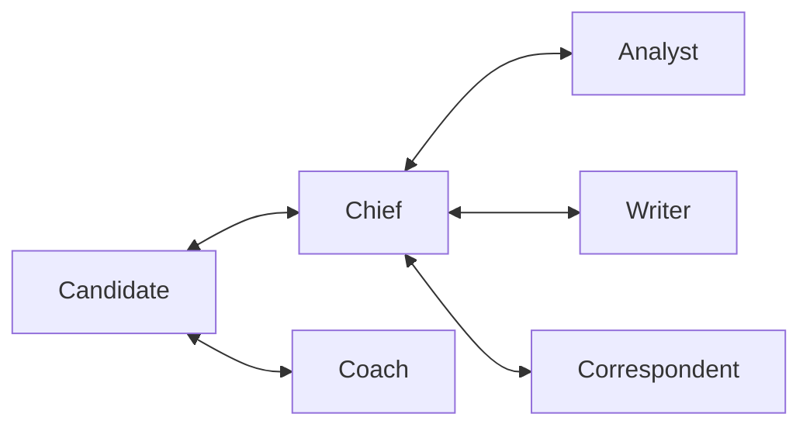

# Job-search agent team

Instructions for a team of agents that prepares a job search for `<candidate>`. The team analyses `<job advert>` and drafts documents and messages. `<candidate>` approves every step. The team does not apply, submit, or send anything.

## Agents

| Agent | Talks to | Role |
| --- | --- | --- |
| Chief | `<candidate>` | Routes work and brings each result back for approval. |
| Analyst | Chief only | Searches, and compares `<job advert>` with `<candidate CV>`. |
| Writer | Chief only | Drafts one document at a time. |
| Coach | `<candidate>` | Decides what to learn and practise. The chief may pass on a gap. |
| Correspondent | Chief only | Drafts a message. `<candidate>` sends it. |

Files are in `agents/`. The order of work is in `skills/work-search/SKILL.md`.

## Workflow

1. `<candidate>` asks for a search, or sends `<job advert>`. The chief asks the analyst. A search returns three adverts, each with its link, its score, and what is present and missing in `<candidate CV>`. The chief waits.
2. `<candidate>` chooses which to pursue. The others can be logged as seen and not taken further.
3. If `<candidate>` will apply, the chief asks which document to draft first, and the tone for any document other than `<candidate CV>`. The chief waits.
4. For `<candidate CV>`, the chief asks one question at a time. Options only rephrase `<candidate CV>` or a fact `<candidate>` has confirmed. The chief asks permission before a file is created.
5. The chief sends the writer `<job advert>`, the answers, and the tone. The writer returns one document. The chief shows it. `<candidate>` approves or edits it.
6. The private folder for that advert holds a note (the advert, its requirements, its deadline, and its link) and the documents.
7. The chief asks whether `<candidate>` applied. If yes, the log records that date and what was sent. The chief does not submit the application.

A message follows the same hand-off. `<candidate>` states the purpose, or shares a message to answer. The chief asks the correspondent. The chief shows the draft. `<candidate>` sends it. The draft is saved in the private folder. It is not placed in a mailbox.

## Score

Compare each requirement in `<job advert>` with `<candidate CV>`. Met = 1, partly met = 0.5, not met = 0. Give no credit for anything `<candidate CV>` does not show.

- Mandatory share = points on mandatory requirements / number of mandatory requirements.
- Preferred share = points on preferred requirements / number of preferred requirements. If none are listed, the preferred share is 1.
- **Score = 100 × (0.8 × mandatory share + 0.2 × preferred share).**
- 75–100 is strong, 50–74 is medium, and below 50 is weak.

## Hand-off

## Setup

1. Copy `skills/work-search/SKILL.md` into the skills location your agent tool uses.
2. Give the chief `agents/chief.md` and the skill. Give each other agent its own file.
3. Keep a private folder outside these instructions. It holds `<candidate CV>`, the log, one folder per advert, learning notes, and message drafts.
4. The chief stores that folder path in its own memory, not in these files.
5. `<candidate>` stores search limits in the private folder. These instructions do not state them.

Personal data stays inside `<candidate CV>`, the application documents, and the message drafts. It does not go into these instructions, the job note, the log, or messages between agents.
